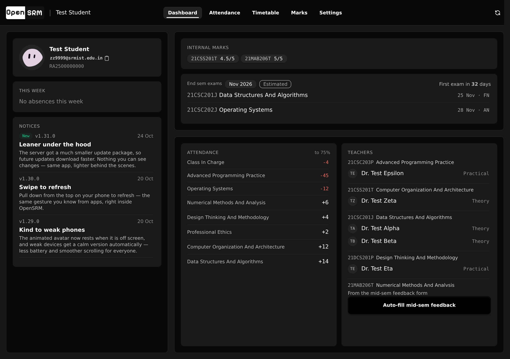
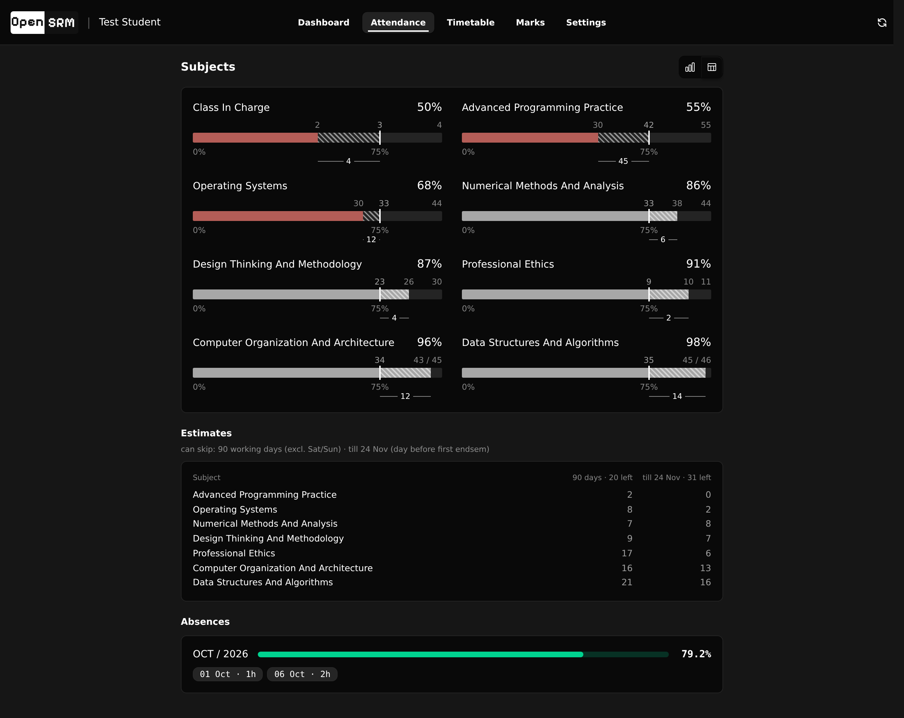
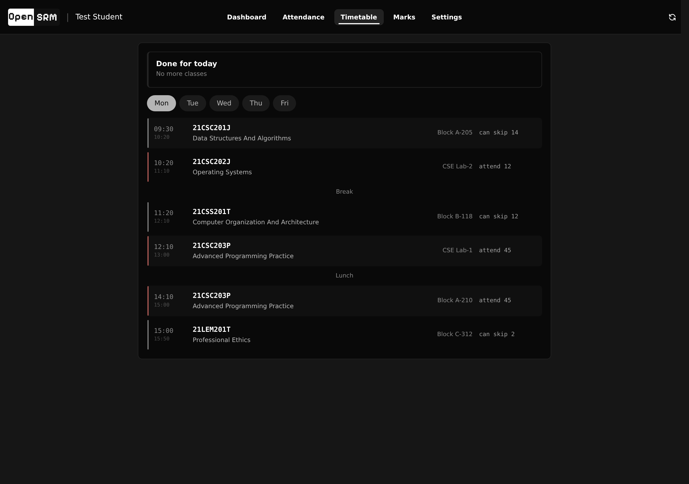
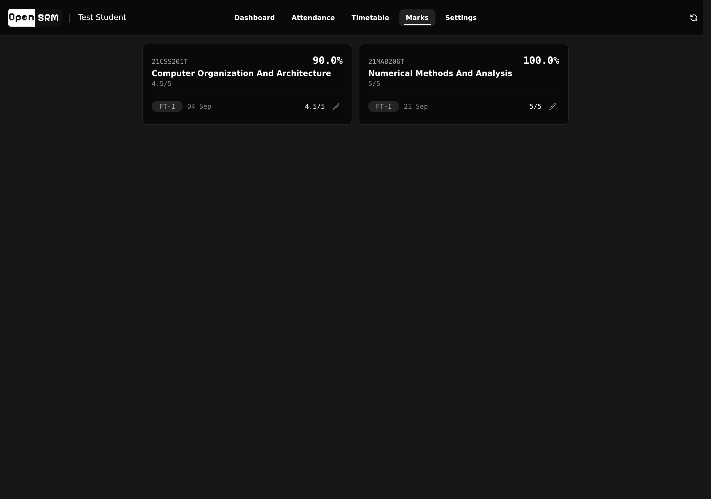
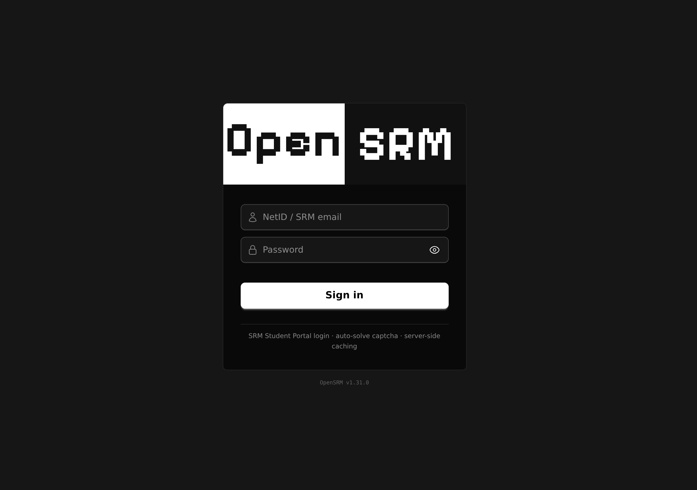
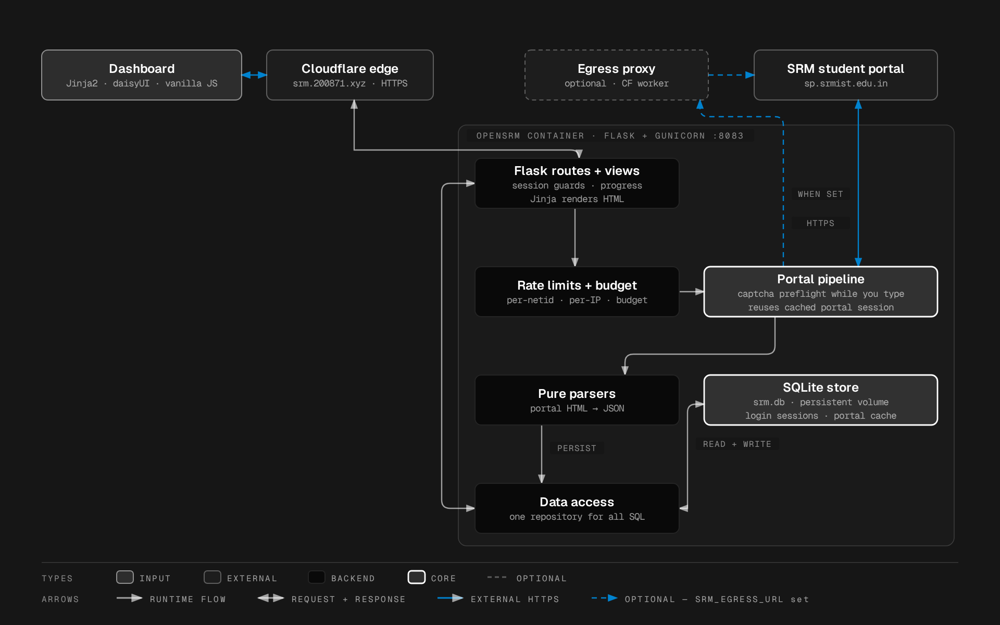

<p align="center">
  
</p>

<p align="center">
  <b>Your whole semester on one dark dashboard.</b><br>
  Attendance, marks, timetable, exam schedule and class reminders —<br>
  a self-hosted, installable web app on top of the SRM Student Portal.
</p>

<p align="center">
  <a href="https://srm.200871.xyz"></a>
  <a href="https://github.com/thenabbu/OpenSRM/actions/workflows/tests.yml"></a>
  <a href="LICENSE"></a>
  <a href="https://www.python.org/downloads/"></a>
</p>

<p align="center">
  <a href="https://srm.200871.xyz">Open the live instance</a> ·
  <a href="#quick-start">Self-host it</a> ·
  <a href="docs/privacy.md">What we store</a>
</p>

---

<p align="center">
  
</p>
<p align="center"><i>The dashboard: everything that matters today, nothing that doesn't. Cards hide themselves when they have nothing to say.</i></p>

## What it does

- **Dashboard** — a card/widget engine, not a fixed page: `LAYOUT` + `WIDGETS` registries in `app/views/layout.py` (re-exported by `app.app`) render a 12-column card grid (day column | marks + exams | attendance + teachers), each widget a self-guarding partial that hides itself when its data is empty and hides its whole card when every widget in it is empty. Widgets: profile (institute email, click-to-copy), a class ticker (previous/current/next class from the real slot grid), weekly absences, internal marks with stale-entry flags, the end-sem schedule with its countdown on the header line, a can-skip glance that mirrors the attendance tab's own numbers (never a second opinion), subject-grouped teachers with their Theory/Practical mode and a scrollable list, and a notices panel for release notes. Adding or removing a card or widget is one registry entry — no template, route or test churn beyond the widget's own partial. On desktop the whole grid fits the viewport exactly — no page scrollbar at 1280×900 (cards stretch to fill, leftover content scrolls inside the card, pinned by `tests/test_dash_fit.py`); mobile keeps normal page scrolling. The notices panel is the release-notes channel, and a notice for the *current* release is mandatory: verify76 `M27` fails when the head notice stops equaling `VERSION`.
- **Reliability** — a corrupt stored row degrades with a logged warning instead of a 500 on every load; a mid-scrape relogin re-reads the fresh portal page instead of the dead session's body and persists the fresh session for the next sync; stored marks/subjects survive a failed or empty fetch (preserve-if-empty, like attendance/personal/exams) and every keep logs its netid + preserved columns as `preserve kept stored data` in `opensrm.auth`; unhandled errors land in one greppable ERROR line with a traceback
- **Login** — authenticates against the SRM portal via a pure-HTTP pipeline (Playwright fallback); accepts netid or email; captcha auto-retry (up to 3 attempts in the HTTP pipeline, 5 via the fallback); live step-by-step progress bar while logging in; **preflight** — the login page warms the portal session and solves the captcha while you're still typing your password; guide-compliant form with floating labels, show/hide toggle, and a Caps-Lock hint that reserves its own row (zero layout shift); rejections are classified on the portal's own alert text, so a wrong password says "invalid credentials" on the first attempt instead of burning 3 captcha retries (and the portal's 3-attempts-per-NetID lockout), and every sync lockout names its real remaining time
- **Sessions** — concurrent per account (phone, laptop, PWA each hold their own 30-day cookie); logging in on one device never evicts the others, `/logout` ignores Cloudflare speculation prefetches so a hover-adjacent touch can't silently kill the session, real logout/expiry events are one auth-log line each, session tokens are stored as sha256 digests (a leaked database yields no live sessions), and cross-site POST/PUT/PATCH/DELETE requests are refused with a 403
- **Attendance** — meter rows per subject (§4.15): exact fill vs a white 75% tick, pinned numbers (attended / 75%-value / total), and the bare must-attend-or-can-skip count on a connector line; semester skip budgets (90-working-day and day-before-first-endsem models) in a quiet Estimates card; absences as `date · hours` chips merged with the monthly breakdown (one block per month, bar + chips together); no aggregate anywhere. Timetable rows carry a text glance signal (can skip N / attend N; neutral "no data" for unmatched or custom slots) and the today hero shows the current class's skip stat
- **Internal Marks** — component-wise marks per subject (name + entered date + score), neutral numbers with a single muted outlier accent, IE-1/IE-2 roles derived from component maxima and confirmable per class (persisted for GPA prediction); glance widget on the dashboard
- **Academics** (SCOPE, feature-gated) — one tab over four interlinked ops: released results grouped by exam semester (grade chips + a quiet Pass badge, an F rendered as error text; provisional/revaluation subsections appear only when those ops carry data), the derived **CGPA (est.)** hero — credit-weighted grade points over released results (O=10 … F=0) rounded half-up, labelled *est.* because SRM has never published its grade scale — plus per-semester SGPA, required-vs-acquired credit bars for the 8 categories (overall `N/163` + latest semester summary) and the full program subject completion grid (grade/month/attempts on completed rows, dim `-` on pending). The navbar item, dock item and panel render only while `SCOPE_FEATURES` includes `academics` **and** the stored scope data holds at least one of its ops
- **End-sem exams** — official schedule from the portal's **Exam Time Table** page (`iden=126`, live since Oct 2026 — the only source with exact clock slots), merged per subject with the legacy `ScribeInner.jsp` leak (`iden=1` + any month/year — the portal doesn't validate against its own dropdown) as the **pre-release fallback**: official rows win per code, scribe rows fill subjects the official page leaves pending. Stamped-date dashboard card (day + weekday + countdown, source badge `Official` / `Official + est.` / `Estimated` derived from clock slots; room allotments from the same table render as `Hall … · Seat …` in the row meta). One-shot Web Push events fire on the estimate→official transition ("official timetable released") and on hall/seat publication or change (~1 day before each exam); card hides itself if no session is seeded or the portal closes the gap — and a portal response that lists subjects *without* dates (seen Oct 2026) never wipes the stored schedule
- **Mid-sem feedback** — harvests the portal's Mid Sem Feedback form during any cold sync while the window is open into the subject→teacher map (the portal's only subject→teacher source — course lists carry no faculty), rendered as a dashboard "Teachers" card. **Filling is opt-in**: an *Auto-fill mid-sem feedback* button under the card opens an explainer modal — how it works (every teacher gets their own form — one portal form per teacher within a subject — 5 = EXCELLENT on all 14 questions, comment "none", live re-verify) plus the exact per-teacher list — and the modal's *Fill feedback* confirm button is the only path that writes to the portal (the sync itself is read-only, paced ~0.7s/request). The endpoint rebuilds the plan server-side from the stored map (same builder as the preview), re-verifies each subject live (already-filled / teacher-changed / window-closed all report honestly), and a closed window or changed portal markup aborts without touching attendance/marks; the stored map is only overwritten by a fresh successful harvest. **Availability-gated (v1.19.0)**: each cold sync classifies the portal's `Service closed` marker into `fb_open` on the user's row — while the window is closed the *Auto-fill* button and its modal don't render at all (the Teachers list keeps its historical data) and the fill endpoint answers 409 without contacting the portal; the first sync that finds the window open again brings the button back automatically.
- **Timetable** — per-group schedule from SQLite, **synced from the portal's Timetable page** (`iden=10`, live since Oct 2026): every sync replaces the group's rows with the published grid stamped `source='official'`. The portal's clock is wrong for this campus (-60/-40 min per period block), so read times go through `TIMETABLE_TIME_OFFSETS` — official+offset is pinned equal to the legacy grid in `tests/test_official_tt.py`; zero every offset plus one fixture re-capture when the portal fixes its clock. No published grid → legacy rows untouched; break/lunch dividers are derived from the corrected gaps (10m / 70m). Current/next class status (only the live class gets a **Now** pill — the Soon badge is retired); every subject row's left rim is attendance-coloured like the attendance meter (grey = comfortably ≥75 · faded yellow = zero margin at 75 · faded red = below 75); **no user input at all**: the drag-and-drop editor entry + save API are archived (`TIMETABLE_EDITOR` unset = shipped default; ops re-enables with `TIMETABLE_EDITOR=enabled` as the fallback if the portal's copy ever breaks); edit history archived alongside the editor (same `TIMETABLE_EDITOR` gate; the log API stays as read-only provenance — every allowed save logs who changed which slot and when)
- **Settings** — one tab that owns everything session-level: a collapsible **Personal details** row (identity header + collapse groups Academic, Personal, Family, Contact with present-field count badges; dense 2-column label-above-value grid with all groups open on desktop, first group only on mobile; click any value to copy it), the consolidated **Notifications** card, and **Log out** (moved out of the navbar/sync area)
- **Hot/cold data** — attendance + marks + the official timetable grid refreshed and persisted on every sync; personal details/courses reused until stale (24h); rendered timetable served from SQLite (cached rows render instantly, even when a fetch fails — preserve-if-empty), so the page shows cached data with a quiet background re-sync
- **Telemetry** — usage events (page views, logins, syncs) counted per netid in the app's own SQLite, same database as everything else; no third-party scripts, no cookies
- **Observability (ops, optional)** — `GET /internal/metrics` exposes counters/timers/gauges (sync outcomes by pipeline and error class, durations, cache hits, captcha attempts, portal cooldown, parse-empty counts, push-tick dead-man) behind a secret header; the sibling compose stack in `ops/observability/` (Prometheus + Grafana + Alertmanager → ntfy) scrapes it (Prometheus/Alertmanager loopback-only, Grafana on the LAN behind a password) — bring-up, panels, alerts and tuning in [docs/runbook.md](docs/runbook.md#observability-stack-optional)
- **PWA** — installable on Android, iOS, Windows; offline shell with cached last-view (network-first so deploys never serve stale JS)
- **Class reminders** — Web Push notification a few minutes before each class (subject, start time, room when set), delivered even with the app closed; opt-in per device with 5/10/15/30-minute lead, a test button with server-side delivery receipts, and iOS Home-Screen guidance — driven by an external every-minute tick ([docs/push.md](docs/push.md))

---

## What is this?

The SRM Student Portal works, but it makes you click through five pages to
answer one question: *am I safe to skip the next class?* OpenSRM signs in
with your NetID, keeps a private cached copy of your attendance, marks,
timetable and exam schedule, and renders all of it as one fast dashboard you
can install on your phone like a real app.

Two promises shape everything:

- **It only ever reads from the portal.** Your data is cached for you, never
  sold, never shared with third parties — there are no third-party scripts,
  trackers or cookies at all. The one feature that writes to the portal
  (mid-sem feedback autofill) is strictly opt-in and shows you exactly what it
  will submit before it does. See [docs/privacy.md](docs/privacy.md).
- **It is honest about attendance.** Every subject shows the exact numbers:
  how many classes you have attended, how many you may still miss and stay at
  75%, and whether today's class can be skipped.

## Features

- **Dashboard** — a card grid (profile, current/next class ticker, weekly
  absences, internal marks, exam countdown, can-skip glance, teachers,
  release notices). Each card is self-guarding: it hides its widgets when
  data is empty, and hides itself when every widget is empty — so the page
  is only ever as loud as your data warrants. On desktop the grid fits the
  viewport exactly, no scrollbar.

- **Attendance that does the math** — per-subject meters against the 75%
  line with pinned *attended / needed / total* numbers, a bare
  *can-skip-or-must-attend* count, semester skip budgets in working days, and
  absences grouped by month. No vanity aggregates.

- **Internal marks** — component-wise marks per subject with entered dates,
  and IE-1/IE-2 roles derived from component maxima (confirmable per class,
  used for GPA prediction).

- **Timetable** — synced from the portal's official timetable grid and
  corrected for the campus clock, with break/lunch dividers, a live *Now*
  pill on the current class, and each subject's left edge colour-coded by
  its attendance tier. There is no manual editor in the shipped app: the
  rendered timetable served from SQLite, so it paints instantly from cache
  even when a fetch fails.

- **Exam schedule** — the portal's official Exam Time Table as the source of
  truth, with a pre-release estimate fallback, per-subject countdown,
  hall & seat when published, and a push notification the moment the official
  timetable drops.

- **Teachers and mid-sem feedback** — the portal's subject→teacher map,
  harvested while the feedback window is open. Filling is opt-in: a button
  opens an explainer listing exactly what will be submitted for every
  teacher, and nothing touches the portal until you confirm.

- **Class reminders** — Web Push a few minutes before each class (subject,
  start time, room), delivered even with the app closed. Per-device lead time
  (5/10/15/30 min), a test button with delivery receipts.

- **Installable PWA** — Add to Home Screen on Android, iOS and Windows. The
  service worker keeps an offline shell (`opensrm-v40` cache): HTML is
  network-first with navigation preload, versioned assets are cache-first,
  so warm visits move zero bytes and deploys never serve stale files.

- **Hot and cold data** — attendance, marks and the official timetable
  refresh on every sync; personal details and course lists are reused until
  they go stale (24 h). The page shows cached data instantly with a quiet
  background re-sync.

- **Private by default** — usage is counted in the app's own SQLite, same
  database as everything else. Passwords are encrypted at rest, sessions are
  stored as digests, and **Delete my data** in Settings erases your account
  in one transaction ([what it touches](docs/privacy.md)).

## Screenshots

| Attendance | Timetable |
|---|---|
|  |  |

| Marks | Login |
|---|---|
|  |  |

## Quick start

```bash
# Production (Docker)
git clone https://github.com/thenabbu/OpenSRM.git
cd OpenSRM
docker compose up -d
# Access at http://localhost:8083  (bound to loopback + the cloudflared gateway, not 0.0.0.0)

# Development (venv)
uv venv .venv && source .venv/bin/activate
uv sync --frozen --extra browser
playwright install chromium
DATA_DIR=./data gunicorn -w 1 --threads 8 -t 120 --worker-class gthread -b 0.0.0.0:8084 app.app:app
# Access at http://localhost:8084
```

Requires Python 3.11+. No Node, no npm — CSS is built ahead of time and
committed. For the full operator path (deploy, rollback, restore drill, key
rotation) see [docs/runbook.md](docs/runbook.md).

## How it works

1. **Preflight** — the moment you focus the password field, the server
   fetches the portal's login page, solves the captcha with OCR and keeps it
   warm for 150 s — all while you are still typing.
2. **Login** — a pure-HTTP pipeline POSTs `LoginServlet` with the portal's
   anti-bot tokens, re-solving the captcha up to 3 times. A wrong password is
   classified from the portal's own alert text and rejected on the first
   attempt — it never burns captcha retries or trips the portal's
   3-attempts-per-NetID lockout. Progress (5% → 92%) streams to the login
   screen.
3. **Sync** — the hot forms (attendance 9, marks 13, timetable 10, exams 126)
   are fetched fresh on every sync and persisted; the cold forms (profile 17,
   courses 7) only when older than 24 h. Everything is rate-limited per account, per IP
   and by an aggregate portal budget, serialized one pipeline at a time
   behind a bounded queue.
4. **Serve** — parsed JSON lives in SQLite; the dashboard renders straight
   from it, so every visit paints instantly and a failed fetch degrades to
   the last good data instead of an error.

## Architecture

One Flask process, one SQLite file, one fetch pipeline — the whole data path,
portal to pixel:

<p align="center">
  
</p>

A sync starts at your browser, crosses the tunnel as a normal HTTP
request/response, and every page renders straight from the store — so the
dashboard keeps working from cache even when the portal doesn't. The pipeline
talks to the portal directly by default; the dashed detour through the egress
worker only exists when `SRM_EGRESS_URL` is set.

A sync starts at your browser, crosses the tunnel, logs in with a captcha
that was already solved while you typed, pulls the hot forms, parses them
with pure functions and lands it all in SQLite — and every page renders
straight from that store, so the dashboard keeps working from cache even
when the portal doesn't.

## Tech stack

| Layer | Technology |
|-------|------------|
| Backend | Flask 3.1, Python 3.11, gunicorn (gthread, single worker) |
| Portal access | Pure HTTP (urllib) pipeline; an archived Playwright fallback stays off unless `PLAYWRIGHT_FALLBACK=enabled` |
| Captcha | ddddocr (self-contained OCR, no external service) |
| Database | SQLite with a versioned migration registry (16 migrations → schema v17) |
| Frontend | Tailwind CSS 4.3.3 + daisyUI 5.7.46, **pre-compiled** into `app/static/app.css` by a pinned, sha256-verified CLI — no runtime CDN. Vanilla JS, Jinja2 |
| PWA | Service worker: navigation-preload HTML, cache-first `?v=` assets, network-first icons |
| CI/CD | GitHub Actions — Lint · Tests (unit + docker + e2e) · Build & Push → `ghcr.io/thenabbu/opensrm` · report-only Scans |
| Deployment | Docker on the lab host, Cloudflare Tunnel for HTTPS |

## Configuration

Defaults are chosen for the live instance; every one is overridable.

| Setting | Default | What it does |
|---------|---------|--------------|
| Port | 8083 | Web interface (compose maps loopback + cloudflared gateway → container 8080) |
| Rate limit (netid) | 3 per 10 min | Scrapes per account — only counted when a sync actually runs; a queued/busy/cooldown rejection is free |
| Rate limit (IP) | 10 per hour | Login attempts per IP |
| Portal budget | 30 per 10 min | Aggregate server→portal requests: full logins + preflights share 20 (preflight capped at 10), refreshes hold a reserved floor of 10, one IP holds at most 6 unauthenticated tokens |
| Sync queue wait | 45 s | How long a sync waits for a running one before returning "Sync in progress" (`SYNC_QUEUE_WAIT_S`; `0` = refuse immediately). Logins queue ahead of refreshes |
| Sync concurrency | 1 | Portal pipelines at once (`SYNC_MAX_CONCURRENCY`) |
| Portal cooldown | 5 → 30 min | After 3 consecutive portal failures: 5 min, doubling, capped at 30 |
| Session | 30 days | Cookie lifetime |
| DB lock wait | 10 s | How long a SQLite statement waits for a lock before failing |

**Environment variables:**

| Variable | Default | Purpose |
|----------|---------|---------|
| `DATA_DIR` | `/app/data` | SQLite data directory (`srm.db`, `fernet.key`, `secret`) |
| `FERNET_KEYS` | unset | Comma-separated encryption keys at rest — **first key encrypts, every key decrypts** (rotation without data loss). Unset → `DATA_DIR/fernet.key`. Runbook: [SECURITY.md](SECURITY.md#key-rotation) |
| `SQLITE_JOURNAL_MODE` | `delete` | `delete` or `wal`. With `wal` a raw file copy is not a safe backup — copy the `-wal`/`-shm` sidecars too or use `sqlite3 ".backup"` |
| `LOG_LEVEL` | `INFO` | DEBUG / INFO / WARNING / ERROR |
| `SYNC_MIN_INTERVAL_S` | `300` | Refresh cache window: a refresh inside it answers from stored data — no portal contact, no quota charge (`0` disables) |
| `SYNC_QUEUE_WAIT_S` | `45` | Seconds a sync waits in queue before the busy error (`0` = refuse immediately) |
| `SYNC_MAX_CONCURRENCY` | `1` | Portal pipelines at once (read at startup) |
| `PLAYWRIGHT_FALLBACK` | unset | Unset = archived: failures return a typed portal-down error, no browser in the image. `enabled` = fall back to Playwright (needs an image built `--build-arg WITH_PLAYWRIGHT=1`) |
| `SRM_EGRESS_URL` + `SRM_PROXY_TOKEN` | unset | Route portal traffic through the optional Cloudflare egress worker instead of direct |
| `PUSH_ENABLED` / `PUSH_DRY_RUN` / `PUSH_ALLOW_NETIDS` | off | Class-reminder rollout controls — [docs/push.md](docs/push.md) |
| `PUSH_TICK_SECRET`, `VAPID_PUBLIC_KEY`, `VAPID_PRIVATE_KEY`, `VAPID_SUBJECT` | unset | Web Push: tick-scheduler auth + VAPID keys (generated once by `scripts/generate_push_keys.py`) |
| `METRICS_SECRET` | unset | Enables `GET /internal/metrics` behind `X-Metrics-Token` for the optional observability stack ([runbook](docs/runbook.md#observability-stack-optional)) |
| `USAGE_EVENTS_RETENTION_DAYS` | `365` | Usage-event retention, pruned automatically |
| `NTFY_ALERT_URL` | unset | ntfy topic for ERROR-level faults (5xx/unhandled), rate-limited to 1/min |
| `CHROMIUM_PATH` | auto | Chromium path for the archived Playwright fallback only |
| `TZ` | `Asia/Kolkata` | Timezone |

### Sync health canary

`bash scripts/canary_sync.sh <netid>` runs **one** real sync against a running
deployment, asserts `ok` plus non-empty attendance and marks, deletes the
minted cookie, and exits non-zero with the reason on any failure — the
operational check that the portal hasn't changed before users notice.
Fabricated netids only; no cron is installed, run it by hand or wire your own
scheduler.

## Security

- Passwords encrypted at rest (Fernet); session tokens stored as sha256
  digests — a leaked database yields no live sessions
- Strict CSP with no external origins; no third-party scripts, fonts or
  trackers anywhere in the app
- Rate limiting per account and per IP, an aggregate portal budget, a bounded
  sync queue and an escalating portal cooldown
- Cross-site state-changing requests refused with 403; strict JSON bodies,
  16 KB cap, parameterized SQL
- Container runs non-root behind a read-only rootfs, `cap_drop: ALL`,
  `no-new-privileges`; Cloudflare Tunnel for HTTPS

Full details, including the key-rotation runbook: [SECURITY.md](SECURITY.md).

## Documentation

- [CONTRIBUTING.md](CONTRIBUTING.md) — setup, PR flow, portal rate limits
- [SECURITY.md](SECURITY.md) — threat model, protections, key rotation
- [docs/privacy.md](docs/privacy.md) — what is stored, what "Delete my data" erases
- [AGENTS.md](AGENTS.md) — quickstart for coding agents: dev loop, test matrix, gotchas
- [DESIGN.md](DESIGN.md) — the `openSRM` daisyUI theme: tokens, components, house rules
- [docs/diagrams.md](docs/diagrams.md) — how repo diagrams are built (pre-rendered, verified, regen commands)
- [docs/push.md](docs/push.md) — Web Push class reminders: architecture, env vars, rollout
- [docs/runbook.md](docs/runbook.md) — operator runbook: build, deploy, rollback, restore, key rotation
- [docs/audit/](docs/audit/) — incident and audit records

## Contributing

Issues and PRs welcome — read [CONTRIBUTING.md](CONTRIBUTING.md) first.

## License

MIT — see [LICENSE](LICENSE). Not affiliated with SRM Institute.
